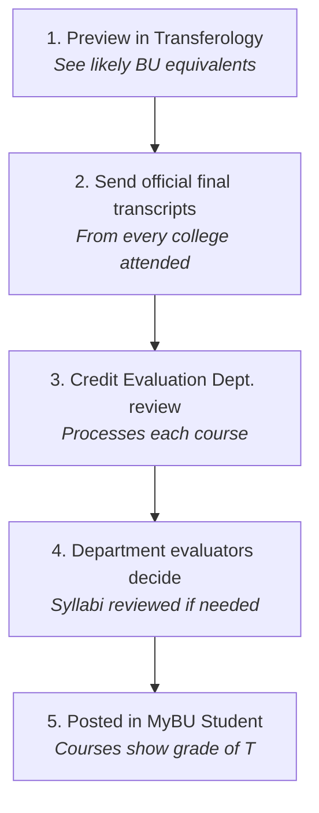
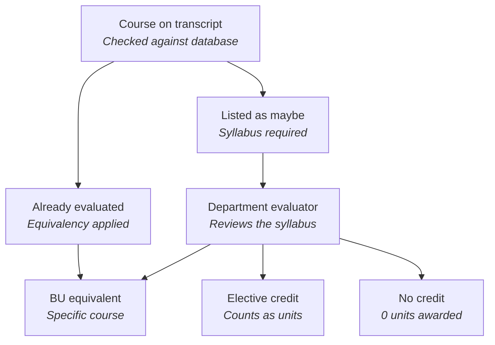
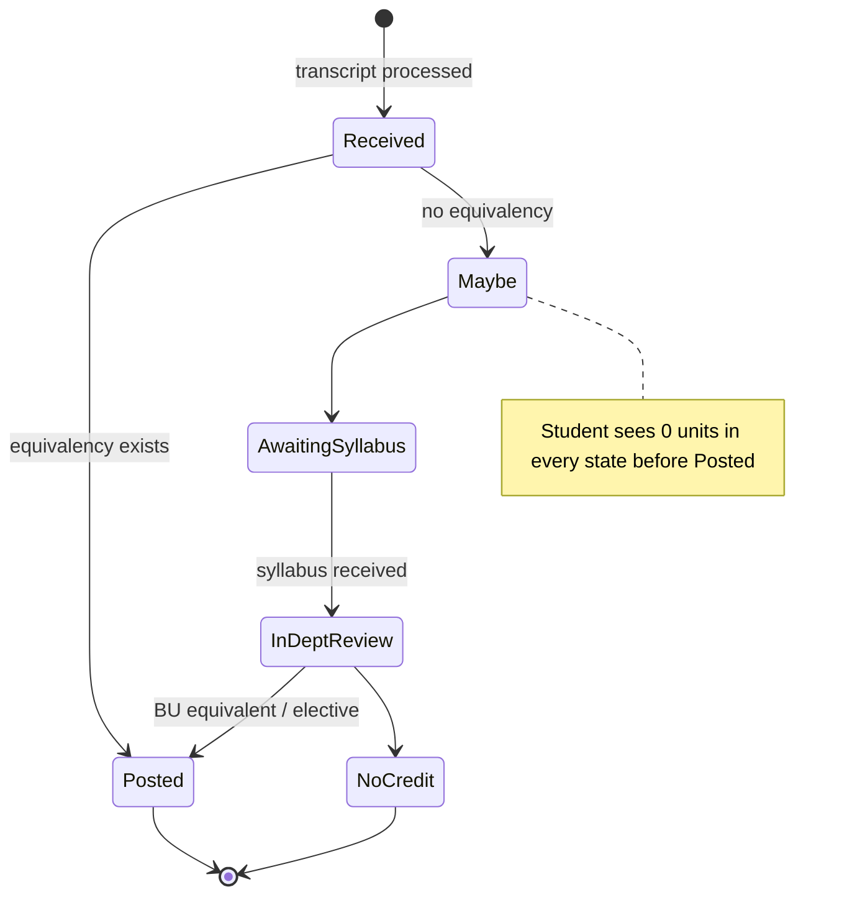

# 02 · Current Process (As-Is)

[← Back to Understanding](../UNDERSTANDING.md)

> Source: brief table "How the work runs today" and Figures 1–2. The brief says steps marked † are the organisers' reading and unconfirmed; the extracted text carried no † marks, so **treat every step as needing confirmation**.

## Step by step

| # | What happens | Who | Tools / data |
|---|---|---|---|
| 1 | **Self-check.** Student previews likely course equivalencies. | Student | Transferology |
| 2 | **Transcripts.** After admission, student submits official final transcripts from every college attended. | Student | Official transcripts |
| 3 | **Processing.** Credit Evaluation processes each course, checking it against the equivalency database. | Credit Evaluation Dept. | Equivalency database |
| 4 | **Known course.** If already evaluated, the existing equivalency is applied → a specific BU course. | Credit Evaluation Dept. | Equivalency database |
| 5 | **Unknown course.** No match → listed as **"maybe"**; student must send a syllabus. | Student | Syllabus |
| 6 | **Department review.** Evaluator reviews the syllabus and decides: BU equivalent, elective credit (counts as units), or no credit (0 units). | Department evaluator | Syllabus; course descriptions, learning outcomes, credit hours |
| 7 | **Result.** Posted in MyBU Student with grade **"T"**. Pending credit shows **0 units** until evaluated. | Credit Evaluation Dept. | MyBU Student |

## Figure 1 — End-to-end flow

## Figure 2 — Decision paths for one transfer course

## Course lifecycle as a state machine (our reading)

Unclear today: is there a state for "grade below C", "BU-only course", "syllabus not obtainable", or "deadline expired"? (→ [06](06_assumptions_and_questions.md))

## Where it breaks

| Break point | Step | Symptom | Who pays |
|---|---|---|---|
| Exact-match lookup only | 3–4 | Near-identical or renumbered courses drop to "maybe" | Student + evaluator |
| Syllabus chase | 5 | Old/unavailable syllabi; student doesn't know which ones matter | Student |
| One-by-one manual comparison | 6 | Repetitive reading of descriptions, outcomes, credit hours | Evaluator |
| Binary status | 7 | 0 units says nothing about progress or likely outcome | Student, advisor, financial aid |
| No feedback loop (assumed) | 6→3 | New decisions may not generalise to similar future courses | Everyone, next cycle |
| Transferology vs. final decision gap (assumed) | 1 vs 6 | Preview may set expectations that review later overturns | Student |

## Hand-offs

Student → Credit Evaluation → Student (syllabus) → Credit Evaluation → Department → Credit Evaluation → MyBU. **At least five hand-offs** for a "maybe" course; each is a queue where time is lost and visibility drops.
