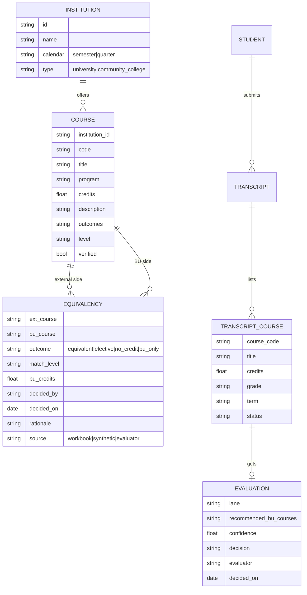

# 04 · Data Inventory

[← Back to Understanding](../UNDERSTANDING.md)

## Files supplied (`_designs/requirements/`)

### 1. `Boston University.docx` — problem brief
Participant problem statement for Hackathon 5.0. Says "four business problems" but **only Problem 1 (Transfer credit evaluation)** is in the file. Contains: task, ground rules, situation, where it sits, as-is workflow (7 steps), rules, facts & numbers, what has been tried, sponsor brief, demo scenario, data promise, problem-specific ground rules, and two process figures. Mentions a **Team Response Template** that was **not supplied**.

### 2. `BU_Transfer_Program_Course_Match.xlsx` — seed data

| Sheet | Rows | Columns | Notes |
|---|---|---|---|
| README | — | — | Purpose, scope, match-level definitions, "Verified" meaning, credit notes, source date (Oct 2026) |
| Transfer Lookup | — | — | Interactive: pick *Northeastern/NYU* + course code → BU equivalent, title, match level, notes (Excel formulas + named ranges `NU_Codes`, `NYU_Codes`) |
| Programs | 5 | 18 | Program-level match for CS, Economics, Psychology, Biology, Mathematics at BU / NU / NYU; key rules; source URLs; match strength (Strong/Moderate) |
| BU Courses | 41 | 8 | Code, title, program, requirement type, credits, verified, notes, source |
| Northeastern Courses | 38 | 8 | Same shape |
| NYU Courses | 38 | 8 | Same shape |
| Course Match | 41 | 13 | **One row per BU course**: closest NU course + level, closest NYU course + level, notes |
| Match Summary | 2 × 5 | 7 | Counts of match levels per program for each peer (formulas) |

**Course schema (all three catalogs):** `Course code · Course title · Program · Requirement type · Credits · Verified (Yes/Check) · Notes · Source`

**Course Match schema:** `BU course · BU title · Program · BU credits · Northeastern course · NU title · NU credits · NU match level · NYU course · NYU title · NYU credits · NYU match level · Notes`

**Match summary (as computed in the workbook):**

| Peer | Likely equivalent | Partial | No equivalent | BU only | % likely |
|---|---|---|---|---|---|
| Northeastern | 21 | 11 | 6 | 3 | 51% |
| NYU | 31 | 6 | 1 | 3 | 76% |

### 3. `Hackathon Discovery Log.xlsx` — question log template
Single sheet, one question per row (rows 5–204). Columns:
- **Participant pod:** Q ID (auto `Q-###`), Problem statement, Team name, Submitted by, Date submitted, Category, Question, Why we're asking, Priority
- **Learning team:** Addressed to, Status, Date sent to business
- **Business:** Response, Responded by, Response date

Example row Q-001 is a template, not real data. Our draft questions are in [06](06_assumptions_and_questions.md), formatted to paste in.

## Data quality observations

| # | Observation | Impact |
|---|---|---|
| DQ-1 | **Course Match is BU-centric** (one row per BU course). Real evaluation is **external-course-centric** (one row per transcript course). | We need to invert it into an equivalency table keyed by `(institution, external code)`. |
| DQ-2 | **Many-to-one mappings** exist: NU MATH 2331 → CS 132 *and* MA 242; NU MATH 3081 → CS 237 *and* MA 581; NU CHEM 1161 → CH 101 *and* CH 102; NYU MATH-UA 120 → CS 131 *and* MA 293; MATH-UA 140 → CS 132 *and* MA 242; MATH-UA 233 → CS 237 *and* MA 581. | A single external course can satisfy different BU requirements; matcher must return multiple ranked candidates. |
| DQ-3 | **Lookup sheet returns only the first match**, so NU MATH 2331 shows *CS 132 – Partial* while *MA 242 – Likely equivalent* is the better answer; same for NYU MATH-UA 233 (CS 237 partial vs MA 581 likely). | Demonstrates why a ranked, multi-candidate answer is needed. |
| DQ-4 | **Peer courses with no BU row**: NU BIOL 2299, BIOL 3611, CS 2700, CS 2800, CS 3100, DS 3000, PSYC 3464; NYU MATH-UA 235, PSYCH-UA 11. Lookup says "No BU match on file". | These are natural "maybe" test cases. |
| DQ-5 | **"Check" rows** (title/credits from memory): BU MA 226; NU MATH 2321, 2331, 2341; NYU CHEM-UA 125/126/225/226. | Flag lower confidence in UI. |
| DQ-6 | **No descriptions / learning outcomes / syllabi** for any course. | Semantic matching needs synthetic descriptions. |
| DQ-7 | **Credit mismatch**: several NU courses are 5 credits (lab bundled) vs BU 4. No rule given. | See CR-04. |
| DQ-8 | Match levels are opinions of the workbook author, not BU decisions. | Use as *proxy* past decisions, labelled as such. |

## Brief's promised data vs. what we have

| Item | Promised | Supplied | Gap |
|---|---|---|---|
| Sample transcripts | 3–4 | 0 | Generate |
| BU courses for one program | ~150 | 41 across 5 programs | Generate ~110 (or narrow scope to one program and deepen) |
| Courses from two other universities | ~200 | 76 (38 NU + 38 NYU) | Generate ~125 |
| Past course-match decisions | ~100 | 0 real; 82 proxy pairs from Course Match | Derive + generate |
| Sample syllabi | "organisers to confirm" | 0 | Generate |
| Equivalency-database extract | "organisers to confirm" | 0 | Derive from Course Match |
| Community-college / quarter-system school | Needed for demo | 0 | Generate |

## Target data model (proposed)

