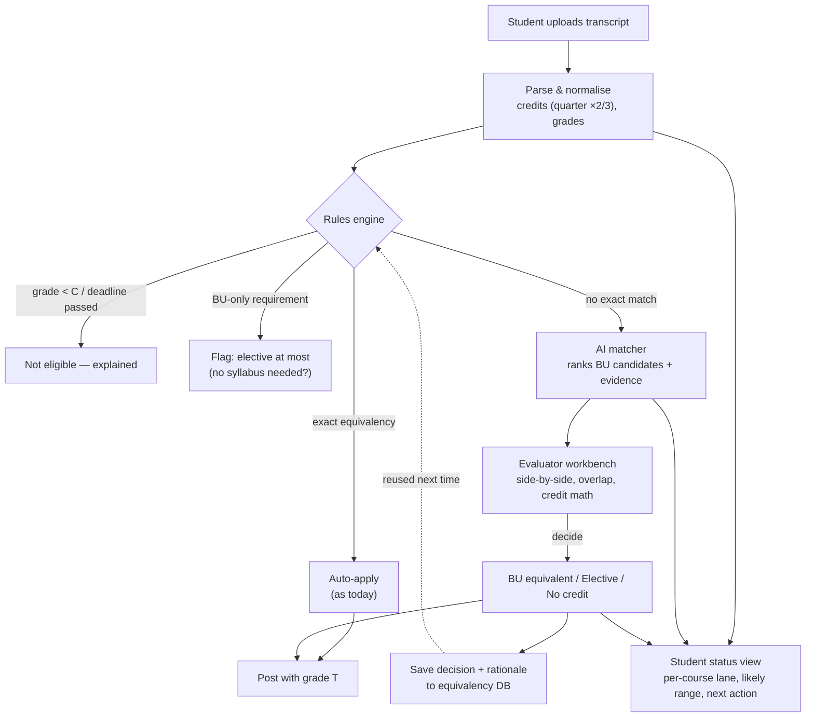

# 07 · Solution Concept (Draft — to discuss)

[← Back to Understanding](../UNDERSTANDING.md)

> A starting proposal so we can "play around". Nothing here is decided.

## Measurable outcome

**Primary:** *Reduce the evaluator handling time for a "maybe" course* — because that path is where the brief places both the evaluator and the student pain.

Since we can't time real evaluators during the hackathon, we prove it with proxies:

| Metric | Definition | How we measure in the hackathon | Target (initial guess) |
|---|---|---|---|
| **Top-3 hit rate** | % of held-out past decisions whose BU course appears in our top-3 candidates | Backtest on workbook + synthetic decisions | ≥ 80% |
| Auto-resolution rate | % of transcript courses resolved by exact/fuzzy equivalency without review | Run over synthetic transcripts | ↑ vs exact-match baseline |
| Provisional-status coverage | % of courses showing a likely outcome at intake (vs 0 units) | Run over synthetic transcripts | 100% have a status; ≥ 70% a likely outcome |
| Syllabus requests avoided | "Maybe" courses where the syllabus would not change the outcome (BU-only, below grade, already capped) | Rule engine on transcripts | Report count |

Post-hackathon (real proof): A/B or before/after on evaluator minutes per course and days-to-posting.

## To-be process

## Components (maps to `src/`)

| Folder | Component | Responsibility |
|---|---|---|
| `src/ai` | Matcher | Embed course title + description + outcomes; rank BU candidates; explain overlap; optional LLM summary of syllabus vs BU course |
| `src/api` | Evaluation service | Transcript intake, rules engine (doc 03 IDs), equivalency store, evaluation workflow & statuses |
| `src/ui` | Two views | **Evaluator workbench** (queue, side-by-side, decide) and **Student tracker** (status, likely credits, actions, degree progress) |

## Course lanes (what both users see)

| Lane | Trigger | Student sees | Evaluator action |
|---|---|---|---|
| ✅ Applied | Exact equivalency | "CAS CS 111 · 4 cr · posted" | none |
| 🟢 Likely match | High-confidence AI candidate | "Likely CAS CS 330 · pending CS dept" | Confirm / change |
| 🟡 Needs syllabus | Low confidence / partial | "Syllabus needed — why it matters" | Review when uploaded |
| ⚪ Elective at most | BU-only / no equivalent | "Likely elective credit" | Confirm |
| 🔴 Not eligible | Grade/deadline | Reason shown | none |

## MVP scope for the hackathon slice

**In:** one program (Computer Science) + Maths support courses; synthetic transcripts (incl. a quarter-system community college); rules CR-01/02, GR-01, PRG-03, OUT-01..05; ranked candidates with explanation; evaluator decision saved back; student status page; backtest script with hit-rate output.

**Out:** real SIS/MyBU integration, authentication, PDF OCR of real transcripts (use structured or simple text transcripts), Hub/GPA logic beyond flags, appeals.

## Tech options (to choose together)

| Concern | Option A (simple) | Option B (richer) |
|---|---|---|
| Matching | TF-IDF / keyword overlap | Embeddings + LLM explanation (Claude) |
| API | Python FastAPI | Node/Express |
| UI | Streamlit | React |
| Store | JSON/CSV/SQLite | Postgres |
